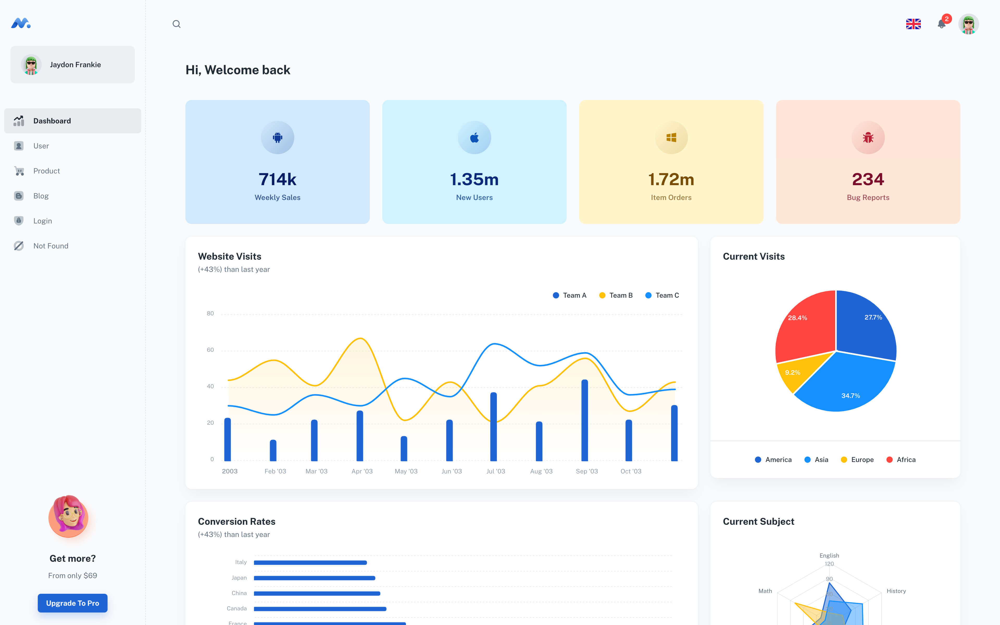

| [Minimal Free](https://minimal-kit-react.vercel.app/) | [Minimal](https://material-ui.com/store/items/minimal-dashboard/) |
| ----------------------------------------------------- | :---------------------------------------------------------------- |
| **6** Demo pages                                      | **50+** demo pages                                                |
| -                                                     | ✓ Multi-language                                                  |
| -                                                     | ✓ Dark/Light Mode 🌓                                              |
| -                                                     | ✓ [More components](https://minimals.cc/components)               |
| -                                                     | ✓ Next.js version                                                 |
| -                                                     | ✓ TypeScript version                                              |
| -                                                     | ✓ Design files (Figma & Sketch)                                   |

## Page demo

- [Dashboard](https://minimal-kit-react.vercel.app/dashboard/app)
- [Users](https://minimal-kit-react.vercel.app/dashboard/user)
- [Product](https://minimal-kit-react.vercel.app/dashboard/products)
- [Blog](https://minimal-kit-react.vercel.app/dashboard/blog)
- [Login](https://minimal-kit-react.vercel.app/login)
- [Not Found](https://minimal-kit-react.vercel.app/404)

## Getting started

- Recommended `node js 16.x` and `npm 6+`. (suggestion v16.15.0)
- Install dependencies: `npm install` / `yarn install`
- Start the project: `npm run start` / `yarn start`

